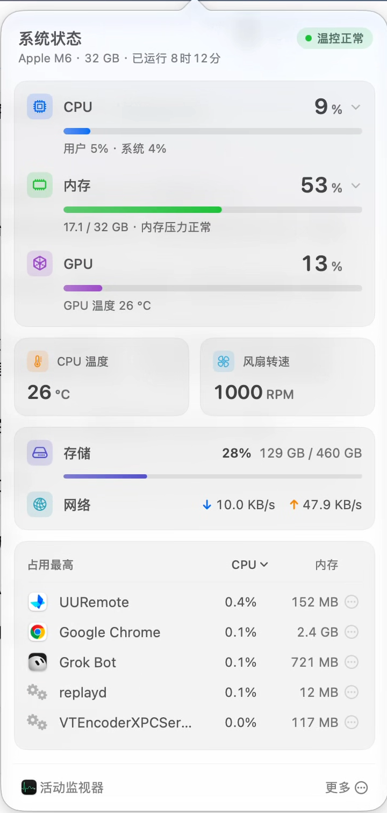
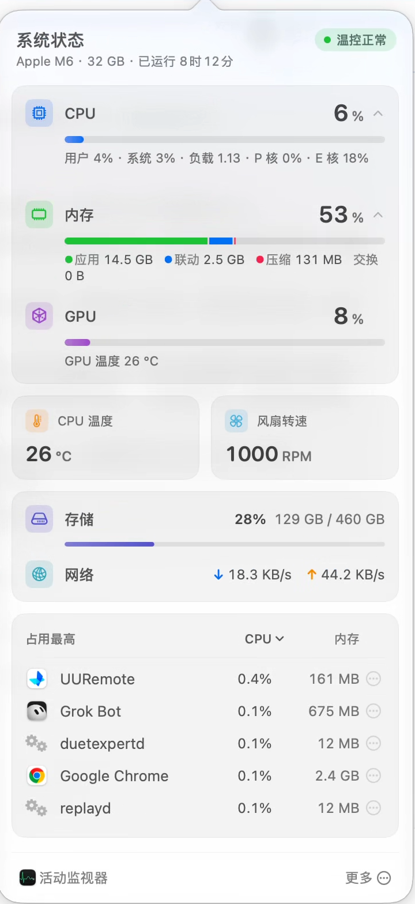

# HardwareStatus

轻量、零外部依赖的 macOS 原生菜单栏硬件监控面板：CPU、内存、GPU、温度、风扇、整机功耗、磁盘、网络与进程占用排行。

当前版本：**2.0.0** · 支持 **macOS 14.0+**（Apple Silicon M1–M6 原生直采，含 M6 三层 S/P/E 核心识别）

## 核心特性

- **原生进程内直采（零外部依赖、无后台 Daemon）**：直接通过 IOKit AppleSMC 读取芯片温度 / 风扇转速 / 整机功耗，并通过 `libIOReport.dylib` 持久订阅读取 GPU 占用、CPU 分层活跃度与模块功耗；无需安装 `macmon`（仅在原生接口不可用时自动作为可选回退）。
- **精准系统指标**：
  - **进程 CPU%**：`proc_pid_rusage(RUSAGE_INFO_V4)` + `mach_timebase_info` 纳秒校正，附 PID 复用校验；后台队列异步扫描，不阻塞主线程。
  - **真实物理网卡 64-bit 速率**：`sysctl(IFMIB_IFDATA)` 仅统计物理接口（`en*` / `pdp_ip*`），过滤 `utun*` / `awdl*` / `bridge*` 等虚拟接口，彻底消除 VPN 双倍统计与 4 GiB 32-bit 回绕。
  - **真实内核内存压力 + Swap**：读取 `kern.memorystatus_vm_pressure_level` 并展示应用 / 联动 / 压缩 / 交换内存。
  - **Apple Silicon 全系核心分级**：自动识别 M6 三层架构（`S 核 / P 核 / E 核`）与 M1–M5 双层架构（`P 核 / E 核`）。
- **极致低功耗设计**：关面板且未显示 GPU 时跳过 IOReport、不扫进程、卸载全局鼠标监听；锁屏 / 休眠完全停采；预解析深浅色菜单栏调色板与 20×20 pt 降采样图标缓存。
- **可选超温风扇加速**：内置滞回防抖、安全最低转速下限（≥ 500 RPM）、异常退出信号恢复保护（需 root 权限写入 SMC；普通用户态自动降级为只读“自动”模式）。
- **原生 AppKit 卡片式面板**：分组卡片、彩色语义进度条、圆角等宽数字、深浅色自适应高对比菜单栏。

## 实测性能（v1.9.1 → v2.0.0）

在 **Apple M6 Mac mini (`Mac18,5`, 12 核 2S+4P+6E, 32 GB, macOS 27.2.1)** 上关面板稳态 10 秒实测：

| 指标 | v1.9.1（旧版 `macmon` 子进程） | v2.0.0（原生直采） | 变化 |
|---|---:|---:|---|
| 自身空闲 CPU | 0.85% | **0.44%–0.59%** | **↓ 31%–48%** |
| 子进程 (`macmon`) CPU | 1.71%（34h 累计 19 分钟） | **0.00%**（0 次派生） | **↓ 100%** |
| **总空闲 CPU** | **2.56%** | **0.44%–0.59%** | **↓ 77%–83%** |
| 常驻物理内存 (`phys_footprint`) | 42.5 MB | **17.7 MB** | **↓ 58%** |
| 峰值物理内存 | 129.7 MB | **18.8 MB** | **↓ 85%** |
| 子进程缺页 (`child_pageins`) | 14,175 | **0** | **↓ 100%** |
| 中断唤醒（/10s） | 38 | **24–33** | **↓ 13%–37%** |

## 效果图





## 要求

- macOS 14.0 或更高版本（Apple Silicon 完整支持；Intel 支持基础系统指标与可选回退）
- Xcode Command Line Tools（`clang` + `swiftc`）
- **无需**第三方依赖或 Homebrew 包

## 构建、测试与安装

```bash
# 仅编译生成 ./HardwareStatus.app
./build.sh

# 编译并运行全部单元 / 原生采样 / 风扇加速与崩溃保护测试
./build.sh --test

# 编译并安装到 ~/Applications（或指定目录）
./build.sh --install
./build.sh --install /path/to/dir
```

### 开机自启（LaunchAgent）

参考 [launchd.HardwareStatus.plist.example](launchd.HardwareStatus.plist.example)，将路径替换为你的 `HardwareStatus.app` 路径后放入 `~/Library/LaunchAgents/`：

```bash
launchctl bootstrap gui/$(id -u) ~/Library/LaunchAgents/local.HardwareStatus.plist
```

模板默认配置 `KeepAlive: { Crashed: true }`：异常崩溃时自动拉起，手动点击「退出」后保持退出。

## 项目结构

```text
Sources/
  Native/
    hw_proc.{h,c}       # proc_pid_rusage (Mach timebase) · 64-bit 物理网卡 · 内核内存压力
    hw_smc.{h,c}        # AppleSMC IOKit 传感器缓存直采 + 风扇读写与崩溃恢复保护
    hw_ioreport.{h,c}   # libIOReport.dylib 持久零休眠订阅 (GPU / S·P·E 核心 / 功耗)
    hw_bridge.h         # Swift / C 桥接头
  App/
    MetricsModels.swift # 数据模型、格式化与时间戳门控 EMA/滞回平滑器
    SystemSampler.swift # 异步原生遥测调度、macmon 回退、后台进程扫描与聚合
    FanBoost.swift      # 可选超温风扇加速状态机与安全策略
    DesignSystem.swift  # 面板布局常量、缓存字体与深浅色语义配色
    StatusTitle.swift   # 菜单栏预解析富文本渲染
    PanelComponents.swift
    MonitorPanelController.swift
    AppDelegate.swift   # @main 入口、生命周期、状态栏交互与降采样图标缓存
Resources/
  Info.plist
Tests/
  CoreTests.swift       # 格式化、平滑器、状态栏渲染与原生 C 实时采样测试
  run_tests.sh
  fanboost/             # 模拟 AppleSMC 状态机与 SIGSEGV 崩溃恢复测试
```

## 用法

- **左键点击状态栏**：展开 / 收起硬件状态面板
- **右键状态栏或面板底部「更多」**：自定义菜单栏显示项（含可选「整机功耗」）与排序、查看数据来源诊断、配置超温风扇加速或退出
- **展开详情**：点击 CPU / 内存行可展开核心分层（`S/P/E`）、1 分钟负载及内存细分（应用 / 联动 / 压缩 / 交换）
- **进程管理**：点击「CPU / 内存」列头切换排序；点击进程行右侧菜单可正常结束或强制结束应用（带 PID 复用校验与权限提示）

## 更多文档

- [更新日志 (CHANGELOG.md)](CHANGELOG.md)
- [性能优化与实测报告 (OPTIMIZATION_REPORT.md)](OPTIMIZATION_REPORT.md)
- [UI 重构设计说明 (VISUAL_REPORT.md)](VISUAL_REPORT.md)

## 许可

[MIT](LICENSE)
