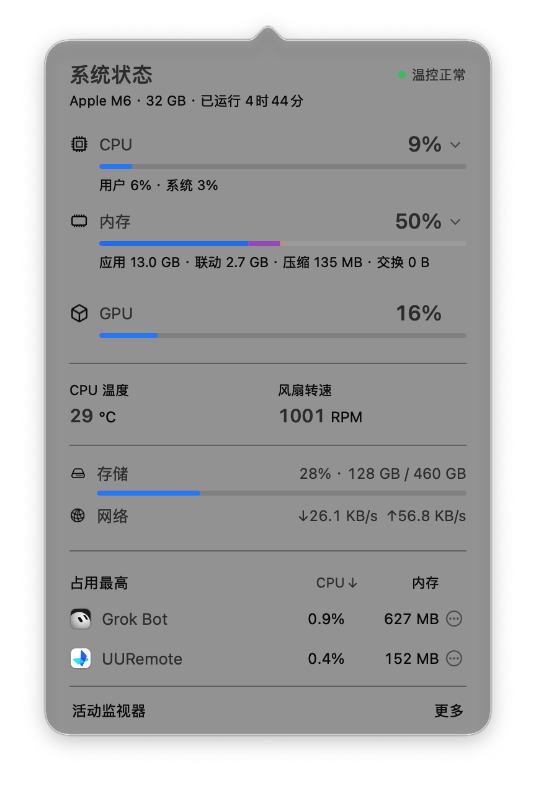

# HardwareStatus

macOS 菜单栏硬件状态面板：CPU、内存、GPU、温度、风扇、磁盘与网络，以及占用最高的进程。

- **单层原生面板**（留白 + 细分隔），克制系统材质
- 状态栏默认：`CPU · 内存 · 温度 · 网络`
- 数据：`macmon` + 系统 API；**无 Daemon**
- 锁屏 / 休眠停采

当前版本：**1.9.1**

## 效果图





## 要求

- macOS（开发目标含较新系统 API；Apple Silicon 已实测）
- 本机已安装 [`macmon`](https://github.com/vladkens/macmon)（或兼容的 `macmon` 可执行文件在 `PATH`）
- Xcode Command Line Tools（`swiftc`）

## 构建与安装

```bash
./build.sh
```

默认产物：`HardwareStatus.app`（同目录）。可拷到任意位置，并用 LaunchAgent 自启（见 `launchd.HardwareStatus.plist.example`，请改成你的路径与用户名）。

## 用法

- 左键状态栏图标：打开面板
- 面板底部「更多」：设置项、诊断与退出
- 占用最高：点列头可按 CPU / 内存排序

## 许可

MIT
