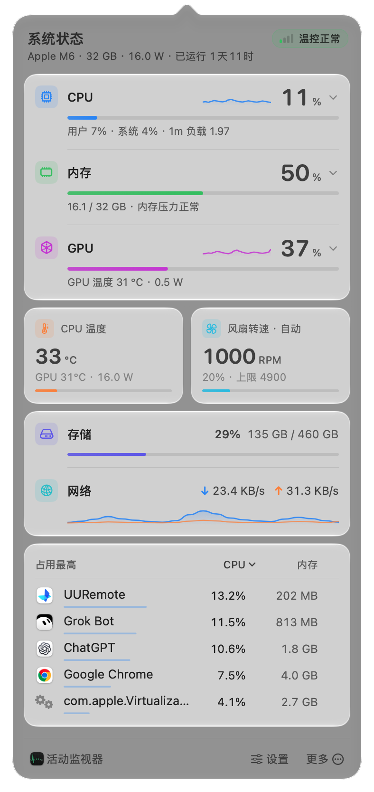
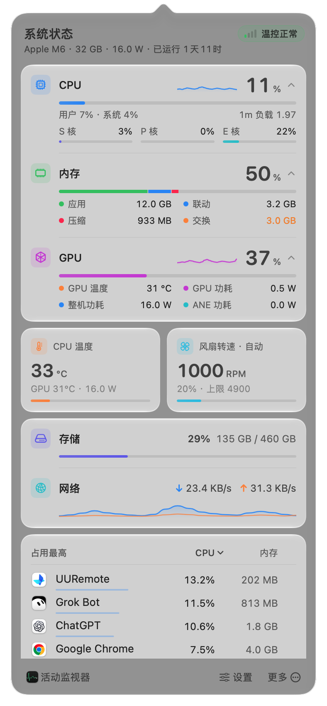
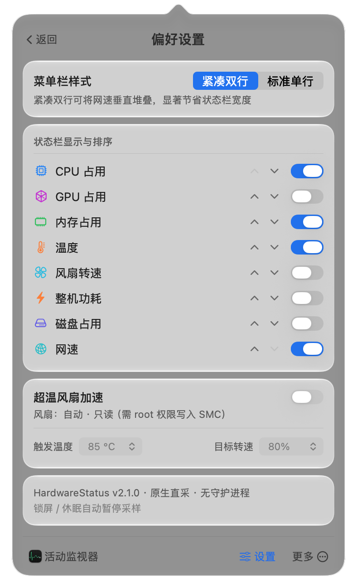

# HardwareStatus

轻量、零外部依赖的 macOS 原生菜单栏硬件监控面板：CPU、内存、GPU、温度、风扇、整机功耗、磁盘、网络与进程占用排行。

当前版本：**2.1.0** · 支持 **macOS 14.0+**（Apple Silicon M1–M6 原生直采，macOS 26/27 原生 Liquid Glass 卡片）

## 核心特性

- **原生进程内直采（零外部依赖、无后台 Daemon）**：直接通过 IOKit AppleSMC 读取芯片温度 / 风扇转速 / 整机功耗，并通过 `libIOReport.dylib` 持久订阅读取 GPU 占用、CPU 分层活跃度与模块功耗；无需安装 `macmon`（仅在原生接口不可用时自动作为可选回退）。
- **高密度菜单栏与 Retina 双行网速**：数值主导排版（12pt Semibold 数值 / 9.5pt 弱化标签），支持「**紧凑双行**」（`@2x` 垂直堆叠 `↑/↓` 网速，实测较旧版缩窄 **36%+**，带滞回动态宽度无抖动）与「**标准单行**」一键切换。
- **macOS 26/27 Liquid Glass 视觉与实时趋势曲线**：
  - macOS 26+ 原生 `NSGlassEffectView` + `NSGlassEffectContainerView` 批处理液态玻璃卡片，macOS 14–15 自动优雅降级。
  - **实时趋势火花线（Sparkline）**：CPU、GPU 与网络（下载/上传双线）采用 GPU `CALayer` 零开销绘制，仅在面板打开时刷新。
  - **结构化展开详情**：CPU 展示 M6 `S/P/E`（或 M1–M5 `P/E`）分层迷你进度条 + 1m 负载；内存与 GPU 采用 2×2 对齐栅格，彻底消除孤字折行。
  - **温度 / 风扇双瓷砖升级**：附 GPU 温度/整机功耗与风扇转速占比/上限 RPM 副标题及 3pt 比例条，点击风扇瓷砖直达设置。
- **面板内原生设置页与进程快捷操作**：
  - 底部 `设置` 按钮在面板内直接切换「紧凑双行 / 标准单行」、开关并一键 `↑/↓` 排序菜单栏指标、配置超温风扇加速，无需翻找多级右键菜单；展开/排序偏好跨重启持久化。
  - 进程排行支持内联占比条、悬停显现 `•••` 按钮、详细路径/进程数 Tooltip，以及点击弹出「在 Finder 中显示 / 复制 PID / 复制路径 / 优雅退出 / 强制结束」快捷菜单。
- **精准系统指标**：
  - **进程 CPU%**：`proc_pid_rusage(RUSAGE_INFO_V4)` + `mach_timebase_info` 纳秒校正，附 PID 复用校验；后台队列异步扫描，不阻塞主线程。
  - **真实物理网卡 64-bit 速率**：`sysctl(IFMIB_IFDATA)` 仅统计物理接口（`en*` / `pdp_ip*`），过滤 `utun*` / `awdl*` / `bridge*` 等虚拟接口，彻底消除 VPN 双倍统计与 4 GiB 32-bit 回绕。
  - **真实内核内存压力 + Swap**：读取 `kern.memorystatus_vm_pressure_level` 并展示应用 / 联动 / 压缩 / 交换内存。
  - **Apple Silicon 全系核心分级**：自动识别 M6 三层架构（`S 核 / P 核 / E 核`）与 M1–M5 双层架构（`P 核 / E 核`）。
- **极致低功耗与惰性面板**：面板首次点击前不创建弹窗/玻璃视图；关面板且未显示 GPU 时跳过 IOReport、不扫进程、不绘火花线、卸载全局鼠标监听；锁屏 / 休眠完全停采。
- **可选超温风扇加速**：内置滞回防抖、安全最低转速下限（≥ 500 RPM）、异常退出信号恢复保护（需 root 权限写入 SMC；普通用户态自动降级为只读“自动”模式）。

## 实测性能（v1.9.1 → v2.1.0）

在 **Apple M6 Mac mini (`Mac18,5`, 12 核 2S+4P+6E, 32 GB, macOS 27.2.1)** 上关面板稳态 10 秒实测：

| 指标 | v1.9.1（旧版 `macmon`） | v2.0.0（原生直采） | v2.1.0（Liquid Glass + 惰性面板） | 相对 v1.9.1 |
|---|---:|---:|---:|---|
| 自身空闲 CPU | 0.85% | 0.44%–0.59% | **0.76%**（含双行 Retina 渲染） | **↓ 11%** |
| 子进程 (`macmon`) CPU | 1.71%（34h 累计 19 分钟） | 0.00% | **0.00%**（0 次派生） | **↓ 100%** |
| **总空闲 CPU** | **2.56%** | **0.44%–0.59%** | **0.76%** | **↓ 70%** |
| 常驻物理内存 (`phys_footprint`) | 42.5 MB | 17.7 MB | **15.6 MB** | **↓ 63%** |
| 峰值物理内存 | 129.7 MB | 18.8 MB | **16.4 MB** | **↓ 87%** |
| 子进程缺页 (`child_pageins`) | 14,175 | 0 | **0** | **↓ 100%** |
| 菜单栏默认宽度（含网速） | 391 pt | 250 pt | **~249 pt（紧凑双行）** | **↓ 36%** |

## 效果图

### 菜单栏（紧凑双行网速）


### 主面板（收起 · 展开结构化详情 · 面板内设置页）
| 主面板 | 展开（M6 S/P/E · 2×2 内存/GPU 栅格） | 面板内偏好设置 |
|:---:|:---:|:---:|
|  |  |  |

## 要求

- macOS 14.0 或更高版本（Apple Silicon 完整支持；Intel 支持基础系统指标与可选回退）
- Xcode Command Line Tools（`clang` + `swiftc`）
- **无需**第三方依赖或 Homebrew 包

## 构建、测试与安装

```bash
# 仅编译生成 ./HardwareStatus.app
./build.sh

# 编译并运行全部单元 / 原生采样 / 风扇加速与崩溃保护测试
./build.sh --test

# 编译并安装到 ~/Applications（或指定目录）
./build.sh --install
./build.sh --install /path/to/dir
```

### 开机自启（LaunchAgent）

参考 [launchd.HardwareStatus.plist.example](launchd.HardwareStatus.plist.example)，将路径替换为你的 `HardwareStatus.app` 路径后放入 `~/Library/LaunchAgents/`：

```bash
launchctl bootstrap gui/$(id -u) ~/Library/LaunchAgents/local.HardwareStatus.plist
```

模板默认配置 `KeepAlive: { Crashed: true }`：异常崩溃时自动拉起，手动点击「退出」后保持退出。

## 项目结构

```text
Sources/
  Native/
    hw_proc.{h,c}       # proc_pid_rusage (Mach timebase) · 64-bit 物理网卡 · 内核内存压力
    hw_smc.{h,c}        # AppleSMC IOKit 传感器缓存直采 + 风扇读写与崩溃恢复保护
    hw_ioreport.{h,c}   # libIOReport.dylib 持久零休眠订阅 (GPU / S·P·E 核心 / 功耗)
    hw_bridge.h         # Swift / C 桥接头
  App/
    MetricsModels.swift # 数据模型、格式化与时间戳门控 EMA/滞回平滑器
    SystemSampler.swift # 异步原生遥测调度、macmon 回退、后台进程扫描与聚合
    FanBoost.swift      # 可选超温风扇加速状态机与安全策略
    DesignSystem.swift  # 面板布局常量、缓存字体与深浅色语义配色
    StatusTitle.swift   # 菜单栏预解析富文本渲染
    PanelComponents.swift
    SettingsView.swift  # 面板内原生偏好设置页（样式、排序、开关、风扇加速）
    MonitorPanelController.swift
    AppDelegate.swift   # @main 入口、生命周期、状态栏交互与降采样图标缓存
Resources/
  Info.plist
Tests/
  CoreTests.swift       # 格式化、平滑器、状态栏渲染与原生 C 实时采样测试
  run_tests.sh
  fanboost/             # 模拟 AppleSMC 状态机与 SIGSEGV 崩溃恢复测试
```

## 用法

- **左键点击状态栏**：展开 / 收起硬件状态面板
- **面板内偏好设置**：点击面板底部「设置」或风扇瓷砖，直接在面板内切换「紧凑双行 / 标准单行」、开关并 `↑/↓` 调整状态栏顺序、配置超温风扇加速；右键状态栏亦可快捷调整
- **展开结构化详情**：点击 CPU / 内存 / GPU 任意一行可展开对应详情（`S/P/E` 核心迷你条、2×2 内存细分栅格、2×2 GPU 温控与分项功耗），展开状态自动记忆
- **进程快捷操作**：点击「CPU / 内存」列头切换排序；悬停或点击进程行弹出快捷菜单（在 Finder 中显示、复制 PID、复制路径、优雅退出、强制结束，带 PID 复用校验与权限提示）

## 更多文档

- [更新日志 (CHANGELOG.md)](CHANGELOG.md)
- [性能优化与实测报告 (OPTIMIZATION_REPORT.md)](OPTIMIZATION_REPORT.md)
- [UI 重构设计说明 (VISUAL_REPORT.md)](VISUAL_REPORT.md)

## 许可

[MIT](LICENSE)
