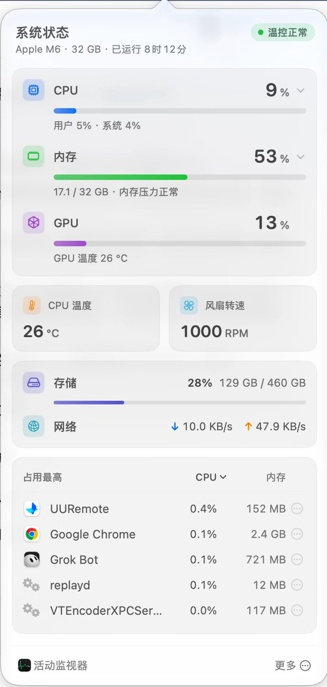
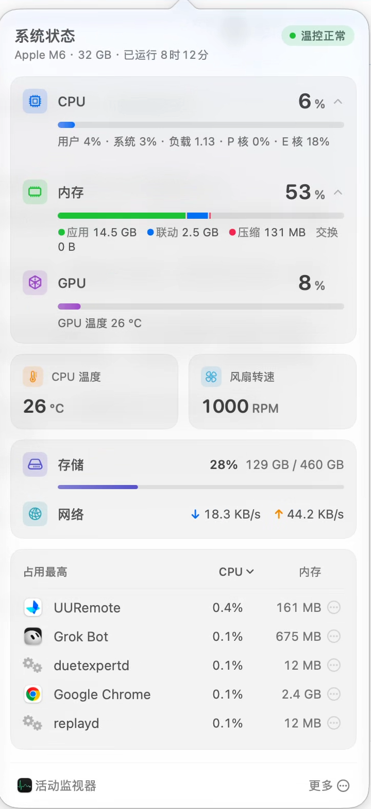

# HardwareStatus

macOS 菜单栏硬件状态面板：CPU、内存、GPU、温度、风扇、磁盘与网络，以及占用最高的进程。

- **卡片式原生面板**（分组卡片 + 彩色指标 + 圆角大数字），系统弹层材质
- 状态栏默认：`CPU · 内存 · 温度 · 网络`（实色高对比文字）
- 数据：`macmon` + 系统 API；**无 Daemon**
- 超温风扇加速：CPU 持续超温时进程内写 SMC 拉高风扇，回落后恢复系统自动（见下文）
- 锁屏 / 休眠停采；关面板时不扫进程

当前版本：**1.9.1**

## 效果图






## 要求

- macOS（开发目标含较新系统 API；Apple Silicon 已实测）
- 本机已安装 [`macmon`](https://github.com/vladkens/macmon)（或兼容的 `macmon` 可执行文件在 `PATH`）
- Xcode Command Line Tools（`swiftc`）

## 构建与安装

```bash
./build.sh
```

默认产物：`HardwareStatus.app`（同目录）。可拷到任意位置，并用 LaunchAgent 自启（见 `launchd.HardwareStatus.plist.example`，请改成你的路径与用户名）。

## 用法

- 左键状态栏图标：打开面板
- 面板底部「更多」：设置项、诊断与退出
- 占用最高：点列头可按 CPU / 内存排序；点 CPU/内存/GPU 行可展开详情

## 超温风扇加速

CPU 温度（与面板「CPU 温度」同一读数，来自 `macmon`）**持续**高于阈值时，App 在进程内直接写 SMC：把风扇切到手动并拉到目标转速；温度降到「阈值 − 回差」后交还系统自动控制。无守护进程、无 helper。

- 默认**开启**：阈值 **85 °C**，目标转速 **最大转速的 80%**（读不到最大值时用 4500 RPM），回差 **5 °C**，需持续超温 **4 秒**（单次尖峰不触发）
- 设置：面板底部「更多」›「超温风扇加速」（开关、触发温度、目标转速、回差、持续超温）
- 状态：面板「风扇转速 · 自动 / 强制加速 / 只读 / 无风扇」，「更多」菜单顶部一行说明；强制加速时风扇读数为橙色
- 只在状态切换时写 SMC，加速期间每 8 秒校验一次（被系统收回时重新设置），不会每个采样周期都写
- 目标转速始终限制在该风扇探测到的最小 / 最大转速之间，且不低于当前转速；**从不写 0 RPM**

**权限**：macOS 只允许 root 写 SMC 风扇键。以普通用户运行时功能自动降级为只读（显示「需以 root 运行才能写入 SMC」），其余监控照常。需要加速时，可用 root 启动可执行文件，例如 `sudo ./HardwareStatus.app/Contents/MacOS/HardwareStatus`（此时设置保存在 root 的偏好里）。无风扇机型（部分 MacBook Air）显示「无风扇机型：无需加速」，不做任何写入。

**恢复自动控制**的时机：温度回落、关闭功能、退出（含 SIGTERM / SIGINT / SIGHUP）、崩溃信号（SIGSEGV / SIGBUS / SIGILL / SIGFPE / SIGABRT / SIGTRAP）、休眠、锁屏、写入权限丢失、温度数据中断超过 30 秒。若进程被强杀（SIGKILL / 断电），系统温控会在进程退出后自行收回控制；下次启动时 App 也会检查遗留标记并恢复自动。

Apple Silicon 实现参考公开研究（[agoodkind/macos-smc-fan](https://github.com/agoodkind/macos-smc-fan) 等）：写 `F{n}Md`（M5 为小写 `F{n}md`，两种都会探测）= 1，再写 `F{n}Tg`；系统拒绝时（如 M4）先写诊断解锁 `Ftst = 1` 并重试。恢复时模式写回 0，并在用过时清除 `Ftst`。Intel 机型为尽力支持（`F{n}Md` 或旧式 `FS! ` 位掩码）；找不到模式键时只读。

> **风险声明**：这会绕过 macOS 默认的风扇策略，使用未公开的 SMC 键（`Ftst` 属诊断接口），各机型行为未全部验证。芯片自身的降频与过热保护始终优先，但本软件按 MIT 许可「按原样」提供，**不提供任何担保**；启用即表示你自行承担可能的硬件风险（噪音、风扇磨损等）。不需要时请在「更多」中关闭。

逻辑测试（Linux，伪 SMC，无需 Mac）：`tests/fanboost/run.sh`（需要 `swiftc` 与 `gcc`/`clang`）。

## 许可

MIT
